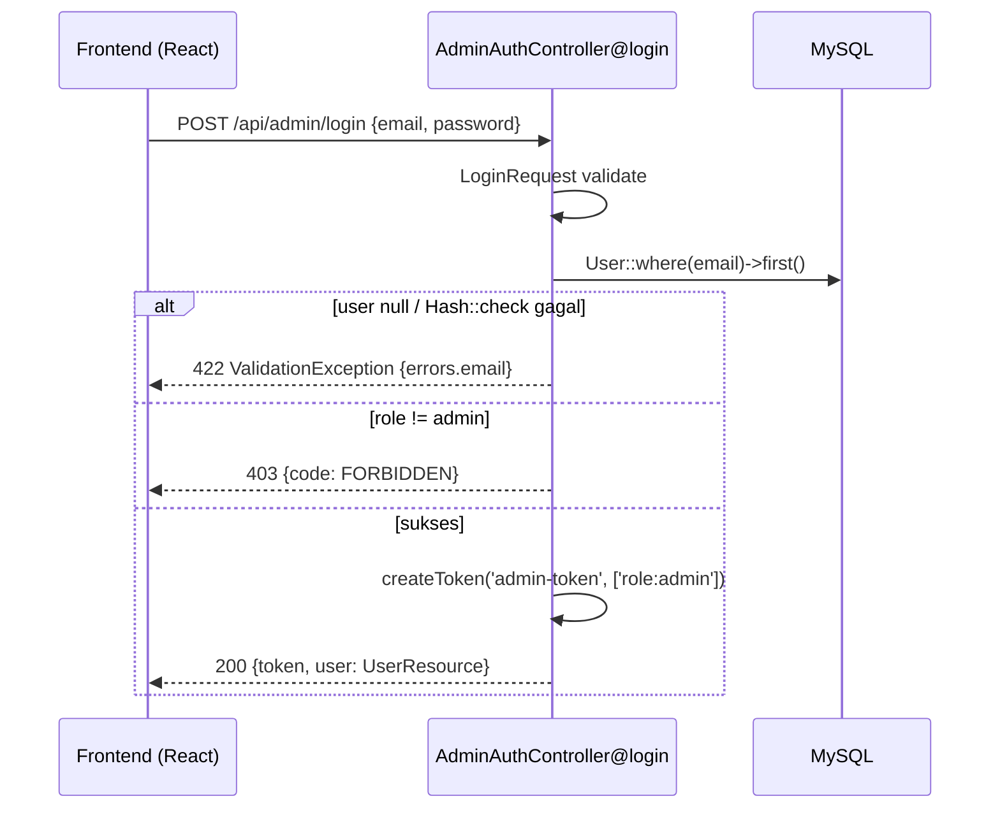
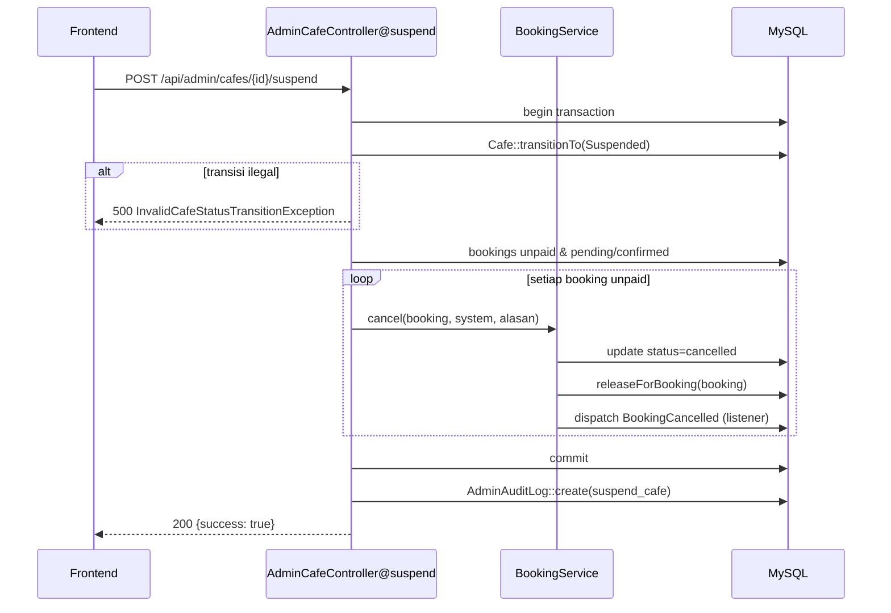
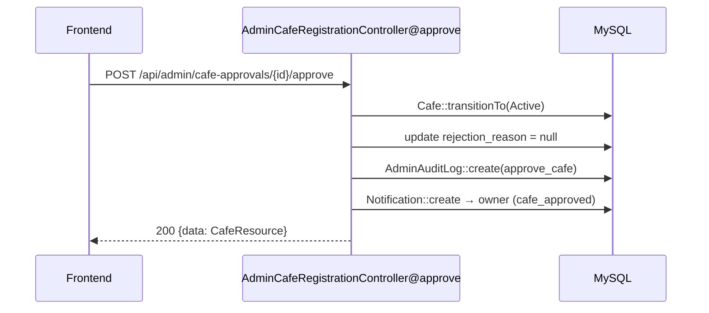
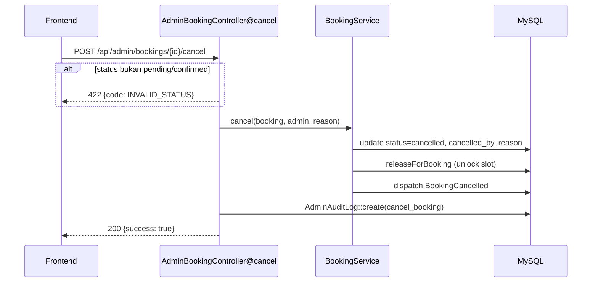
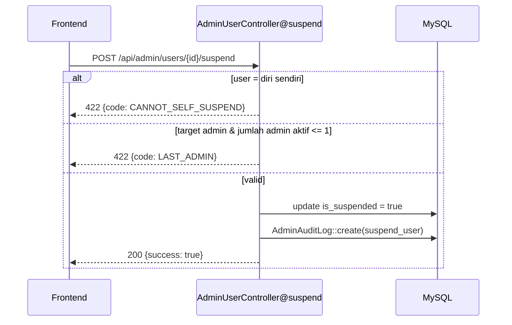

# Blueprint Workflow & Fitur Role Admin — CafeNow

**Teknologi:** Laravel (PHP 8.4, `declare(strict_types=1)`) + Eloquent ORM + Sanctum + Inertia/React (TypeScript)
**Persistence:** SQL Database (MySQL, Eloquent ORM)
**Arsitektur:** Layered (Route → Controller → Service → Model), tanpa repository layer
**Entry Point:** API (JSON) + halaman Inertia untuk rendering SPA
**Cakupan dokumen:** seluruh endpoint role admin (`routes/api/admin.php`, 25 endpoint) + halaman admin + auth admin.

---

## 1. Daftar Endpoint Admin

Semua API admin berada di balik `middleware(['auth:sanctum', 'role:admin'])` dengan prefix `/api/admin` (`routes/api/admin.php:17`). Pengecualian: login admin di `POST /api/admin/login` (public, `throttle:auth`).

| Grup | Method | URI | Controller@Method |
|---|---|---|---|
| Auth | POST | `/api/admin/login` | `Auth\AdminAuthController@login` |
| Dashboard | GET | `/api/admin/dashboard` | `AdminDashboardController@index` |
| Dashboard | GET | `/api/admin/dashboard/recent-activity` | `AdminDashboardController@recentActivity` |
| Analytics | GET | `/api/admin/analytics` | `AdminAnalyticsController@index` (render Inertia) |
| Analytics | GET | `/api/admin/analytics/platform` | `@platform` |
| Analytics | GET | `/api/admin/analytics/revenue` | `@revenue` |
| Analytics | GET | `/api/admin/analytics/cafes` | `@topCafes` |
| Analytics | GET | `/api/admin/analytics/bookings/status` | `@bookingStatus` |
| Analytics | GET | `/api/admin/analytics/commission` | `@commission` |
| Analytics | GET | `/api/admin/analytics/export-csv` | `@exportCsv` |
| Cafes | GET | `/api/admin/cafes` | `AdminCafeController@index` |
| Cafes | GET | `/api/admin/cafes/{cafe}` | `@show` |
| Cafes | POST | `/api/admin/cafes/{cafe}/suspend` | `@suspend` |
| Cafes | POST | `/api/admin/cafes/{cafe}/unsuspend` | `@unsuspend` |
| Approvals | GET | `/api/admin/cafe-approvals` | `AdminCafeRegistrationController@index` |
| Approvals | GET | `/api/admin/cafe-approvals/{cafe}` | `@show` |
| Approvals | POST | `/api/admin/cafe-approvals/{cafe}/approve` | `@approve` |
| Approvals | POST | `/api/admin/cafe-approvals/{cafe}/reject` | `@reject` |
| Featured | GET/POST/PUT/DELETE | `/api/admin/featured-cafes` + `/{featuredCafe}` | `AdminFeaturedCafeController` (`apiResource` minus `show`) |
| Bookings | GET | `/api/admin/bookings` | `AdminBookingController@index` |
| Bookings | GET | `/api/admin/bookings/{booking}` | `@show` |
| Bookings | POST | `/api/admin/bookings/{booking}/cancel` | `@cancel` |
| Refunds | GET | `/api/admin/refunds` | `AdminRefundController@index` |
| Refunds | GET | `/api/admin/refunds/{refund}` | `@show` |
| Refunds | POST | `/api/admin/refunds/{refund}/process` | `@process` |
| Refunds | POST | `/api/admin/refunds/{refund}/reject` | `@reject` |
| Commissions | GET | `/api/admin/commissions/rates` | `AdminCommissionController@rates` |
| Commissions | GET | `/api/admin/commissions/history` | `@history` |
| Commissions | PATCH | `/api/admin/commissions/rates/{type}` | `@updateRate` |
| Users | GET | `/api/admin/users` | `AdminUserController@index` |
| Users | PATCH | `/api/admin/users/{user}` | `@update` |
| Users | POST | `/api/admin/users/{user}/suspend` | `@suspend` |
| Users | POST | `/api/admin/users/{user}/unsuspend` | `@unsuspend` |
| Audit | GET | `/api/admin/audit-logs` | `AdminAuditLogController@index` |

**Halaman Inertia admin** (`routes/web.php:98-110`, juga `role:admin`): `admin/dashboard`, `admin/cafe-approvals`, `admin/cafes`, `admin/featured-cafes`, `admin/bookings`, `admin/orders`, `admin/refunds`, `admin/analytics`, `admin/commissions`, `admin/users`, `admin/audit-logs` — dirender dari `resources/js/pages/admin/**`.

> **Catatan temuan:** `AdminOrderController` (`app/Http/Controllers/Admin/AdminOrderController.php`) ada dan lengkap (list order dengan `MenuOrderResource`) tetapi **TIDAK terdaftar** di `routes/api/admin.php`. Halaman `admin/Order/Oversight` terdaftar tapi tidak punya sumber data API. Ini dead code — endpoint `GET /api/admin/orders` perlu didaftarkan atau controller dihapus.

## 2. Workflow Per Grup Endpoint

### 2.1 Auth — Login Admin

**Tujuan:** otentikasi admin untuk mendapatkan token Sanctum dengan kemampuan `role:admin`.
**Trigger:** submit form login di halaman admin.
**File:** `AdminAuthController.php`, `LoginRequest.php`, `User.php`, `UserResource.php`.

**Alur:**
1. `POST /api/admin/login` (throttled `auth`) → `AdminAuthController@login`
2. `LoginRequest` memvalidasi `email` (required, email) & `password` (required)
3. `User::where('email', ...)->first()` + `Hash::check()`
4. Guard: `$user->role !== UserRole::Admin` → 403 `FORBIDDEN`
5. `createToken('admin-token', ['role:admin'])` → token + `UserResource`

**Poin penting:** gagal kredensial dilempar sebagai `ValidationException::withMessages(['email' => ...])` → 422 dengan `{errors: {email: [...]}}`. Bukan wrapper `success:false` (inkonsisten dengan controller lain).

```php
$token = $user->createToken('admin-token', ['role:admin'])->plainTextToken;
```

**Guard role global** (`CheckRole.php`): `abort(403, 'Tidak memiliki akses')` jika role tidak cocok — diterapkan di route group, bukan per-method.

---

### 2.2 Dashboard

**Tujuan:** ringkasan metrik platform + aktivitas terbaru admin.
**Trigger:** admin membuka `/admin/dashboard`.
**File:** `AdminDashboardController.php`, `CommissionService.php`, `AdminAuditLog.php`.

**`index()`** — render Inertia `admin/dashboard`; metrik dihitung via query Eloquent langsung:
- `totalCafes`: count `approval_status = active`
- `revenueToday`: `sum(total_price)` booking completed hari ini × `activeBookingRate()/100` (rate komisi aktif)
- `activeBookings`: count status `pending`
- `pendingApprovals`: count cafe `pending`
- `newCustomers`: user role customer dibuat hari ini
- `newOrders`: booking dibuat hari ini

**`recentActivity()`** — 10 log terakhir `AdminAuditLog` (dengan relasi `admin`), diterjemahkan ke label bahasa Indonesia via `activityMessage()` (map action → label) dan `entityLabel()` (resolve nama entitas: cafe→nama, user→nama, booking→referensi, refund→`#id`, featured→nama cafe).

---

### 2.3 Analytics

**Tujuan:** laporan bisnis + ekspor CSV.
**File:** `AdminAnalyticsController.php`, `Booking.php`, `Cafe.php`, `User.php`.

| Endpoint | Logika |
|---|---|
| `platform` | Count per role user, per status cafe, per status booking; `sum(cafe_receives)` booking completed |
| `revenue?start_date&end_date` | Group-by `DATE(created_at)`, `COALESCE(SUM(commission),0)` booking completed |
| `topCafes?top=N` | `withCount('bookings')` + `withSum('bookings','commission')`, filter `status='approved'` (kolom legacy — beda konvensi, lihat Pitfall), sort desc, limit N |
| `bookingStatus` | Count completed / pending / cancelled |
| `commission?period=daily\|weekly\|monthly&from&to` | Validasi period; `whereBetween('booking_date')`; group-by format `Y-m-d` / `Y-W` / `Y-m`; sum commission, total_price, count |
| `exportCsv?start_date&end_date` | CSV manual: header `Tanggal,Cafe,Revenue`, baris per booking completed; response `text/csv` + `Content-Disposition: attachment` |

---

### 2.4 Manajemen Cafe (List, Suspend, Unsuspend)

**Tujuan:** pencarian & moderasi cafe aktif.
**Trigger:** aksi admin di halaman `admin/Cafe/Management`.
**File:** `AdminCafeController.php`, `BookingService.php`, `Cafe.php`, `Booking.php`.

**`index`**: filter `keyword` (LIKE nama cafe **atau** nama owner via `orWhereHas`), filter `status` (approval_status), paginate default 25.

**`suspend`** — alur ber-transaksi:
```php
DB::transaction(function () use ($cafe): void {
    $cafe->transitionTo(CafeApprovalStatus::Suspended);

    $unpaid = $cafe->bookings()
        ->where('payment_status', 'unpaid')
        ->whereIn('status', ['pending', 'confirmed'])
        ->get();

    foreach ($unpaid as $booking) {
        $this->bookingService->cancel(
            $booking,
            CancelledBy::System->value,
            'Dibatalkan otomatis karena cafe di-suspend',
        );
    }
});
```
- Transisi status via state machine `Cafe::transitionTo()` → exception `InvalidCafeStatusTransitionException` jika ilegal (mis. active→rejected)
- **Kompensasi (compensating action):** semua booking unpaid yang pending/confirmed dibatalkan otomatis dengan alasan sistem (dalam 1 transaksi DB)

**`unsuspend`**: guard manual `approval_status !== suspended` → `InvalidCafeStatusTransitionException`; lalu `transitionTo(Active)`.

Keduanya menulis audit log via trait `LogsAdminActions` (`AdminAction::SuspendCafe` / `UnsuspendCafe`).

---

### 2.5 Persetujuan Cafe (Approvals)

**Tujuan:** review registrasi cafe oleh owner; setujui/tolak.
**Trigger:** aksi di halaman `admin/Cafe/Approvals`.
**File:** `AdminCafeRegistrationController.php`, `CafeApprovalStatus.php`, `CafeResource.php`, `Notification.php`.

**`index`**: default filter `approval_status = pending` (kecuali query `status` diberikan), eager-load `owner, photos, tables, menuItems`, format manual via `formatCafe()` (bukan Resource — menyertakan foto/tabel/menu dengan URL `asset('storage/...')`).

**`approve`**:
1. `transitionTo(CafeApprovalStatus::Active)` + `update(['rejection_reason' => null])`
2. `AdminAuditLog::create` (action `approve_cafe`, before/after value)
3. `Notification::create` ke owner (`cafe_approved`, delivery_status `sent`)

**`reject`**:
1. Validasi inline `reason` required max 1000 (ada `RejectCafeRequest` di `app/Http/Requests/Admin/` tapi **tidak dipakai** — validasi inline di controller)
2. `transitionTo(Rejected)` + simpan `rejection_reason`
3. Audit log `reject_cafe` + notifikasi `cafe_rejected` berisi alasan

**State machine `CafeApprovalStatus`:**
```
pending   → active | rejected
rejected  → pending   (fix-then-resubmit)
active    → suspended
suspended → active
```
`Cafe::isContentEditable()` = true saat active/approved/rejected (owner bisa edit & resubmit).

---

### 2.6 Featured Cafes

**Tujuan:** kurasi cafe unggulan (tampil di halaman publik dengan urutan).
**Trigger:** CRUD di halaman `admin/Cafe/Featured`.
**File:** `AdminFeaturedCafeController.php`, `FeaturedCafe.php`, `FeaturedCafeResource.php`.

| Method | Perilaku |
|---|---|
| `index` | Semua featured + relasi `cafe`, order `display_order` |
| `store` | Validasi `cafe_id` exists, `display_order` min 0, `active_from` required date, `active_to` after active_from; **guard duplikat** → 409 `CONFLICT`; `created_by = user()->id`; audit `add_featured_cafe`; 201 |
| `update` | Validasi parsial; update 3 field; audit `update_featured_cafe` |
| `destroy` | Hard delete; audit `remove_featured_cafe`; 204 tanpa body |

Catatan: controller ini (dan `AdminCafeRegistrationController`) memakai pola audit langsung `AdminAuditLog::create` dengan action **string literal** — bukan enum `AdminAction` seperti controller lain (inkonsistensi konvensi, lihat Pitfall).

### 2.7 Oversight Booking

**Tujuan:** pantau & batalkan booking dari sisi platform.
**Trigger:** aksi di halaman `admin/Booking/Oversight`.
**File:** `AdminBookingController.php`, `BookingService.php`, `CancelledBy.php`.

**`index`**: filter `keyword` (LIKE `booking_code`), `status`, `cafe_id`; paginate 50; eager-load `cafe, customer`.

**`cancel`**:
1. Guard status: hanya `pending`/`confirmed` (const `CANCELLABLE_STATUSES`) → selain itu 422 `INVALID_STATUS`
2. `bookingService->cancel($booking, CancelledBy::Admin->value, $reason)` — service: update status `cancelled` + `cancelled_by` + reason, **release lock tabel** (`LockService::releaseForBooking`), dispatch event `BookingCancelled`
3. Audit log `cancel_booking`

(Untuk `BookingService::cancel` via admin: guard waktu 3 jam hanya berlaku bila `cancelledBy === 'customer'` — admin dapat membatalkan kapan saja.)

---

### 2.8 Refund

**Tujuan:** proses permintaan refund dari customer.
**Trigger:** aksi di halaman `admin/Refund/Queue`.
**File:** `AdminRefundController.php`, `RefundRequest.php`.

| Method | Perilaku |
|---|---|
| `index` | Filter `status`; paginate 50; eager-load `booking, customer` |
| `show` | Detail refund + relasi |
| `process` | `update(status='completed', admin_notes)`; audit `process_refund` |
| `reject` | `update(status='rejected', admin_notes=reason)`; audit `reject_refund` |

**Catatan:** tidak ada guard status (refund yang sudah completed bisa diproses lagi), tidak ada transaksi/validasi request, tidak ada pemanggilan `MidtransService::refund()` untuk refund aktual di sisi payment gateway. Workflow paling sederhana dari semua grup admin.

---

### 2.9 Komisi

**Tujuan:** kelola rate komisi platform (booking & menu_order).
**Trigger:** aksi di halaman `admin/Commission/Management`.
**File:** `AdminCommissionController.php`, `CommissionRule.php`, `CommissionService.php`.

| Method | Perilaku |
|---|---|
| `rates` | Semua rule → `[{type, percentage}]` |
| `history` | Filter `type`; paginate 50; eager-load `setByAdmin`; latest first |
| `updateRate` | `CommissionRule::where('commission_type', $type)->first()`; jika ada → update `percentage` (`$request->float('percentage')`), audit `update_commission`. **Tidak ada validasi** (range, type valid) dan tidak ada logika pembuatan rule baru |

**Konsumsi:** `CommissionService::activeBookingRate()` (dipakai dashboard & perhitungan booking) membaca rule aktif (`active_from <= now`, `active_to >= now` atau null, latest `active_from`), fallback default 15% booking / 10% menu. `CommissionRule` berisi `set_by_admin_id` tapi `updateRate` **tidak mengisinya**.

---

### 2.10 Manajemen User

**Tujuan:** kelola user platform (nama/email, suspend).
**Trigger:** aksi di halaman `admin/User/Management`.
**File:** `AdminUserController.php`, `User.php`, `UserRole.php`.

**`index`**: filter `keyword` (name/email LIKE), `role`; paginate 50.

**`update`**: `$request->only(['name', 'email'])` (tanpa FormRequest); audit `update_user`.

**`suspend`** — dua guard bisnis:
1. **CANNOT_SELF_SUSPEND** (422): `$user->id === $request->user()->id`
2. **LAST_ADMIN** (422): jika target admin aktif dan jumlah admin aktif ≤ 1
3. `update(['is_suspended' => true])`; audit `suspend_user`

**`unsuspend`**: set false; audit `unsuspend_user`.

Pola error: `{success: false, error: {code, message}}` dengan status 422.

---

### 2.11 Audit Logs

**Tujuan:** jejak audit seluruh aksi admin (list, filter, paginate).
**Trigger:** halaman `admin/User/AuditLogs`.
**File:** `AdminAuditLogController.php`, `AdminAuditLog.php`.

Filter: `admin_id`, `action`, `entity_type`, `date_from` (`whereDate >=`), `date_to` (`whereDate <=`); paginate 100; eager-load `admin`; latest first.

**Model `AdminAuditLog`**: `timestamps = false`, kolom `admin_id, action, entity_type, entity_id, before_value (array), after_value (array), ip_address, created_at`. Semua mutasi status admin menulis 1 baris: action (enum/string), snapshot before/after, IP.

---

## 3. Service Layer

Tidak ada service khusus admin (`app/Services/Admin` kosong). Controller admin memakai dua service domain:

**`BookingService::cancel(Booking $booking, string $cancelledBy, ?string $reason = null): void`** (`app/Services/Booking/BookingService.php:105`)
- Guard 3 jam hanya untuk `cancelledBy === 'customer'`
- Update status + `cancelled_by` + reason
- `lockService->releaseForBooking($booking)` — lepaskan kunci slot
- `BookingCancelled::dispatch($booking->id, $cancelledBy, $reason)` — event

**`CommissionService`** (`app/Services/Payment/CommissionService.php`) — `readonly class`, dipakai dashboard & perhitungan komisi booking:
- `calculateBookingCommission(float $amount): float`
- `activeBookingRate(): float`
- `calculateMenuCommission(float $amount): float`
- `getActiveRate(string $type)` — query `CommissionRule` aktif + fallback default

**Pola DI:** constructor injection `private readonly` (Laravel auto-resolve, tanpa binding manual). `AdminDashboardController` ← `CommissionService`; `AdminCafeController` & `AdminBookingController` ← `BookingService`.

**Trait `LogsAdminActions`** (`app/Traits/LogsAdminActions.php`) — cross-cutting concern audit:
```php
protected function logAdminAction(
    Request $request, string $action, string $entityType,
    int $entityId, array $before = [], array $after = [],
): void
```

---

## 4. Data Mapping Patterns

Tidak ada mapper DTO (tidak ada AutoMapper). Pola yang ada:

1. **Manual array mapping** — `AdminCafeRegistrationController::formatCafe()` membangun array response manual dengan denormalisasi (URL foto absolut, tabel/menu flatten, `location = city ?: address`).
2. **API Resource** — `CafeResource`, `FeaturedCafeResource`, `MenuOrderResource` untuk response terstruktur (approve/reject cafe, featured, order).
3. **Eloquent `only()`** — snapshot before/after untuk audit (`$user->only(['name','email'])`).
4. **Eloquent cast** — `CommissionRule.percentage` & `Booking.commission` di-cast `decimal:2`, `facilities`/`operational_hours` → `array`; serialisasi JSON otomatis.

---

## 5. Data Access Implementation

**Pola:** query langsung Eloquent di controller (tanpa repository). Semua query memakai query builder + eager loading + pagination:

```php
$query = Cafe::with('owner');
if ($request->filled('keyword')) {
    $query->where('name', 'like', "%{$request->keyword}%")
          ->orWhereHas('owner', fn ($q) => $q->where('name', 'like', "%{$request->keyword}%"));
}
$cafes = $query->paginate($request->integer('per_page', 25));
```

Pola umum per list endpoint:
- Filter opsional: `$request->filled('x')` + `where`
- `$request->integer('per_page', 25|50|100)` — default bervariasi per controller
- Response pagination: `{total, per_page, current_page, last_page}` (di sebagian controller diekstrak ke `paginationMeta()` privat)

**Transaksi:** hanya di `AdminCafeController@suspend` (`DB::transaction`) — karena multi-tulis (transisi status + pembatalan booking).

**Relasi penting:** `Cafe.owner/tables/menuItems/photos/bookings/featured`, `Booking.cafe/customer/table/payment/refundRequest`, `RefundRequest.booking/customer`, `FeaturedCafe.cafe/createdBy`, `AdminAuditLog.admin`, `CommissionRule.setByAdmin`.

## 6. Response Construction

**Dua format response yang berbeda di codebase:**

**A. Format legacy (mayoritas):**
```json
{ "success": true, "data": [...], "pagination": { "total": ..., "per_page": ..., "current_page": ..., "last_page": ... } }
```
dipakai: cafes, bookings, refunds, commissions, users, audit-logs, dashboard recent-activity.

**B. Format Resource (lebih baru):**
```json
{ "success": true, "data": [ResourceCollection] | Resource, "meta": { "current_page", "last_page", "total" } }
```
dipakai: `AdminFeaturedCafeController`, `AdminCafeRegistrationController` (approve/reject), `AdminOrderController`.

**Status code:** 200 default; **201** saat create (`featured-cafes` store); **204** delete; **422** validasi/bisnis guard (`INVALID_STATUS`, `CANNOT_SELF_SUSPEND`, `LAST_ADMIN`); **403** role/salah akun; **409** duplikat (`CONFLICT`); **500** exception tak tertangani.

**Error response pattern:**
```json
{ "success": false, "data": null, "error": { "code": "CANNOT_SELF_SUSPEND", "message": "..." } }
```
(untuk `ValidationException`: `{errors: {field: [...]}}` — bentuk berbeda).

---

## 7. Error Handling Patterns

| Layer | Mekanisme |
|---|---|
| Route guard | `CheckRole` middleware → `abort(403)` |
| Validasi input | Inline `$request->validate([...])` mayoritas; `FormRequest` hanya di auth (`LoginRequest`) & reject cafe (`RejectCafeRequest` — tidak terpakai) |
| Bisnis guard | Return JSON 422 inline (booking cancel, user suspend) ATAU throw domain exception (`InvalidCafeStatusTransitionException`) |
| Global | Handler Laravel default; `ValidationException` → 422 `{errors}` |

**Catatan inkonsistensi (potensi bug):**
- Guard bisnis memakai dua gaya: throw exception (`Cafe::transitionTo`) vs return JSON 422 (booking cancel, user suspend). Exception `InvalidCafeStatusTransitionException` akan menghasilkan 500, bukan 422, karena tidak ada handler khusus → user melihat error generic.
- `AdminCommissionController@updateRate` dan `AdminRefundController@process/reject` tidak punya validasi input maupun guard status.
- `AdminAnalyticsController@topCafes` memakai `where('status', 'approved')` — kolom legacy; konsisten dengan `Cafe::transitionTo` yang memetakan `'approved'` → `Active`, tapi tidak konsisten dengan controller lain yang memakai `approval_status`.

**Logging:** tidak ada `Log::` eksplisit di controller admin; jejak mutasi tersimpan di `AdminAuditLog` (before/after + IP). Event `BookingCancelled` di-subscribe listener async (log + notifikasi).

---

## 8. Asynchronous Processing Patterns

- **Event → Listener:** `BookingService::cancel` me-dispatch `BookingCancelled`; `BookingConfirmed` dipakai flow lain. Tidak ada queue worker khusus — event listener sinkron.
- **Notifikasi in-DB:** `Notification::create` langsung (bukan `Notification` Laravel class) — tabel `notifications` diisi dengan `delivery_status = 'sent'` (approve/reject cafe).
- **Tidak ada** job queue, webhook, atau cron khusus admin. `exportCsv` sinkron (cocok untuk skala data kecil).

---

## 9. Testing Approach

Test admin berada di `tests/Feature/Admin/` (Pest/PHPUnit, `RefreshDatabase`):

| File | Cakupan |
|---|---|
| `AdminAnalyticsConsolidationTest.php` | Endpoint analytics + agregasi |
| `AdminAuditLoggingTest.php` | Penulisan audit log pada aksi admin |
| `AdminBookingControllerTest.php` | List & cancel booking |
| `AdminRefundControllerTest.php` | List, show, process, reject refund |
| `AdminUserSuspendGuardTest.php` | Guard `CANNOT_SELF_SUSPEND` & `LAST_ADMIN` |
| `DashboardCommissionTest.php` | Metrik dashboard + rate komisi |

**Pola fixture:** `User::factory()->create(['role' => 'admin'])` lalu `$this->actingAs($admin)`, akses `getJson('/api/admin/...')` + assertion `assertJsonPath`. Contoh (`AdminRefundControllerTest`):

```php
private function makeRefund(): array
{
    $admin = User::factory()->create(['role' => 'admin']);
    $customer = User::factory()->create(['role' => 'customer', 'name' => 'Budi Refund']);
    $booking = Booking::factory()->create(['customer_id' => $customer->id, 'payment_status' => 'paid']);
    $refund = RefundRequest::create([...]);
    return [$admin, $refund];
}
```

Belum ada test untuk: featured cafes, commissions, audit-log filter, cafe approvals, login admin, admin orders.

---

## 10. Sequence Diagram

### 10.1 Login Admin


### 10.2 Suspend Cafe (dengan kompensasi booking)


### 10.3 Approve Cafe


### 10.4 Cancel Booking (Admin)


### 10.5 Suspend User (dengan guard bisnis)


## 11. Naming Conventions

| Aspek | Konvensi | Contoh |
|---|---|---|
| Controller | `Admin{Entity}Controller` di `App\Http\Controllers\Admin` | `AdminRefundController` |
| Auth controller | `AdminAuthController` di `App\Http\Controllers\Auth` (bukan folder Admin) | — |
| Method | `index`, `show`, `store`, `update`, `destroy` (CRUD) + `{action}` verb untuk mutasi | `suspend`, `unsuspend`, `approve`, `reject`, `process`, `cancel` |
| Route naming | Prefix `/api/admin/{entity}`, action verb sebagai sub-route `POST .../suspend` | — |
| Trait audit | `LogsAdminActions` (bukan `AdminLoggingService`) | — |
| Enum | `AdminAction` (case PascalCase, value snake_case string) | `SuspendCafe = 'suspend_cafe'` |
| State machine | `CafeApprovalStatus` + method `transitionTo()` di model | — |
| Request | `{Entity}Request` di `App\Http\Requests\Admin` | `RejectCafeRequest` |
| Resource | `{Entity}Resource` di `App\Http\Resources` | `FeaturedCafeResource` |
| Service | `{Domain}Service` di `App\Services\{Domain}` | `BookingService`, `CommissionService` |
| Model | Singular PascalCase | `RefundRequest`, `CommissionRule` |
| File organization | `resources/js/pages/admin/{Domain}/{Feature}.tsx` | `admin/Refund/Queue.tsx` |

**Ketidakkonsistenan yang ditemukan:** audit log ditulis dengan 2 gaya (enum `AdminAction` di sebagian, string literal di `AdminFeaturedCafeController` & `AdminCafeRegistrationController`); pagination meta berbentuk `pagination` di sebagian dan `meta` di sebagian lain; `AdminOrderController` tidak terdaftar di route.

---

## 12. Implementation Templates

### 12.1 Endpoint admin baru (mengikuti pola terbaik codebase)

**1. Route** (`routes/api/admin.php` — di dalam group `auth:sanctum` + `role:admin`):
```php
Route::prefix('vouchers')->group(function () {
    Route::get('/', [AdminVoucherController::class, 'index']);
    Route::post('/{voucher}/activate', [AdminVoucherController::class, 'activate']);
});
```

**2. Controller** (`app/Http/Controllers/Admin/AdminVoucherController.php`) — pola: strict types, `readonly` DI, `LogsAdminActions`, guard inline JSON:
```php
<?php

declare(strict_types=1);

namespace App\Http\Controllers\Admin;

use App\Enums\AdminAction;
use App\Http\Controllers\Controller;
use App\Models\Voucher;
use App\Traits\LogsAdminActions;
use Illuminate\Http\Request;
use Illuminate\Http\JsonResponse;

class AdminVoucherController extends Controller
{
    use LogsAdminActions;

    public function index(Request $request): JsonResponse
    {
        $query = Voucher::with('creator');

        if ($request->filled('status')) {
            $query->where('status', $request->string('status'));
        }

        $vouchers = $query->latest()->paginate($request->integer('per_page', 50));

        return response()->json([
            'success' => true,
            'data' => $vouchers->items(),
            'pagination' => [
                'total' => $vouchers->total(),
                'per_page' => $vouchers->perPage(),
                'current_page' => $vouchers->currentPage(),
                'last_page' => $vouchers->lastPage(),
            ],
        ]);
    }

    public function activate(Request $request, Voucher $voucher): JsonResponse
    {
        if ($voucher->status !== 'inactive') {
            return response()->json([
                'success' => false,
                'data' => null,
                'error' => ['code' => 'INVALID_STATUS', 'message' => 'Voucher tidak dalam status inactive'],
            ], 422);
        }

        $before = ['status' => $voucher->status];
        $voucher->update(['status' => 'active']);

        $this->logAdminAction(
            $request,
            AdminAction::ActivateVoucher->value, // tambah case di AdminAction
            'voucher',
            $voucher->id,
            $before,
            ['status' => 'active'],
        );

        return response()->json(['success' => true, 'message' => 'Voucher activated']);
    }
}
```

**3. Enum action baru** (`app/Enums/AdminAction.php`):
```php
case ActivateVoucher = 'activate_voucher';
```

**4. Test** (`tests/Feature/Admin/AdminVoucherControllerTest.php`):
```php
final class AdminVoucherControllerTest extends TestCase
{
    use RefreshDatabase;

    public function test_activate_requires_inactive_status(): void
    {
        $admin = User::factory()->create(['role' => 'admin']);
        $voucher = Voucher::factory()->create(['status' => 'active']);

        $this->actingAs($admin)
            ->postJson("/api/admin/vouchers/{$voucher->id}/activate")
            ->assertStatus(422)
            ->assertJsonPath('error.code', 'INVALID_STATUS');
    }
}
```

### 12.2 Checklist implementasi fitur admin baru

1. Tambah enum action baru ke `AdminAction` (jika aksi mutable)
2. Tambah route di group admin (`routes/api/admin.php`)
3. Buat controller dengan strict types + `LogsAdminActions`
4. Guard bisnis: return JSON 422 `{code, message}` — jangan throw exception tanpa handler
5. Tulis audit log (before/after snapshot) di setiap mutasi
6. Tambah halaman Inertia di `resources/js/pages/admin/**` + route `web.php`
7. Tulis test di `tests/Feature/Admin/` (factory user admin + `actingAs` + `assertJsonPath`)

---

## 13. Implementation Guidelines

### 13.1 Proses Implementasi Bertahap

Urutan membangun fitur admin baru: **enum action → model (state machine jika perlu) → route → controller → halaman Inertia → test**. Cross-cutting concern yang wajib diintegrasikan: role middleware (`role:admin`), audit log (`LogsAdminActions`), pola response `{success, data, pagination|meta}`.

### 13.2 Pitfall Umum

1. **Dua bentuk error guard** — pilih satu: return JSON 422 `{error: {code, message}}`. `InvalidCafeStatusTransitionException` saat ini menghasilkan 500; tambahkan `render()` di exception atau tangkap di controller untuk 422.
2. **Kolom legacy `status='approved'`** vs `approval_status` — selalu pakai `approval_status` (atau scope `Cafe::active()`), jangan `where('status', 'approved')` seperti `topCafes`.
3. **Refund & komisi tanpa guard** — `process` refund dapat menimpa refund completed; `updateRate` tanpa validasi range; tambahkan guard `INVALID_STATUS` dan validasi.
4. **`active_to`/`active_from`** pada `CommissionRule` & `FeaturedCafe` harus divalidasi relatif (`after:active_from`).
5. **N+1** — selalu eager-load relasi yang dipakai response (pola `with('owner', 'customer')` sudah konsisten).
6. **Perfomance analytics** — `commission()` melakukan `get()` lalu group di memory; untuk volume besar, gunakan `DATE_FORMAT` di query (group by DB).
7. **Suspension user tidak invalidasi token** — user yang di-suspend masih bisa memakai token Sanctum lama sampai `Sanctum::tokensCanExpire` / middleware cek `is_suspended` diterapkan.

### 13.3 Mekanisme Ekstensi

- **State machine** — tambah transisi baru cukup di `CafeApprovalStatus::TRANSITIONS` tanpa menyentuh controller.
- **Enum `AdminAction`** — satu sumber kebenaran untuk daftar aksi audit; `AdminDashboardController::activityMessage()` memetakan label (tambah label di map saat enum bertambah).
- **Rate komisi** — perubahan rate berlaku otomatis via `CommissionService::getActiveRate()` (date-range active), tanpa mengubah kode perhitungan.
- **Service DI** — injeksi `readonly` constructor; tambah service baru cukup dengan type-hint di constructor.

---

## Kesimpulan

Pola yang paling penting untuk dipertahankan saat menambah fitur admin baru:

1. **AuthZ via middleware group** — `auth:sanctum` + `role:admin` di route group, bukan per-method.
2. **Controller tipis + service untuk logika domain** — `BookingService::cancel`, `CommissionService`; jangan taruh logika multi-langkah di controller.
3. **Audit di setiap mutasi** — `LogsAdminActions` dengan snapshot before/after + IP; konsisten gunakan enum `AdminAction`.
4. **State machine untuk status domain** — `transitionTo()` di model dengan transisi eksplisit, bukan update status bebas.
5. **Guard bisnis → 422 JSON terstruktur** — `{success: false, error: {code, message}}` (kecuali validasi form → `{errors}`).
6. **Response paginated konsisten** — `{success, data, pagination}` dan prefer eager-load + `per_page` dari request.
7. **Kompensasi dalam transaksi** — multi-tulis (suspend cafe + batal booking) harus satu `DB::transaction`.
8. **Test per controller** di `tests/Feature/Admin/` dengan factory + `actingAs` admin.


