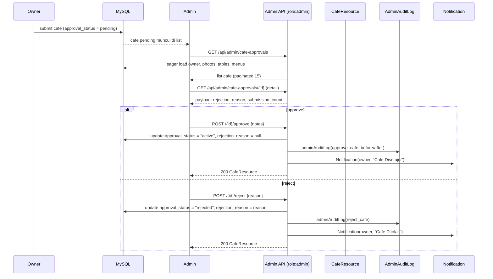
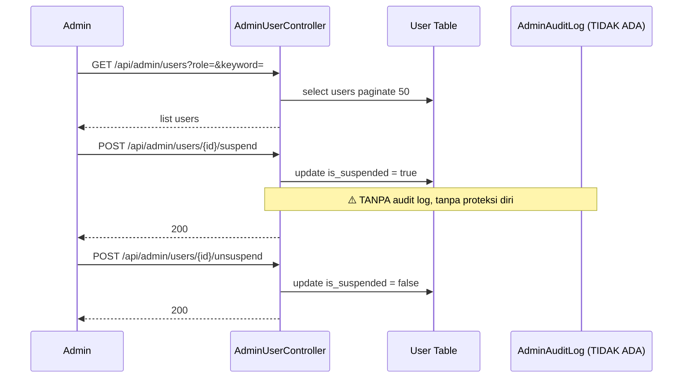
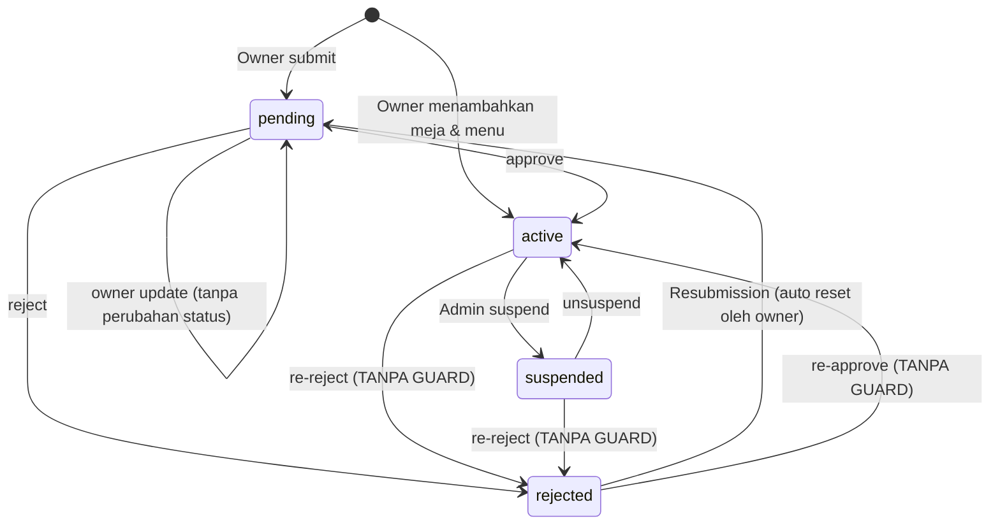
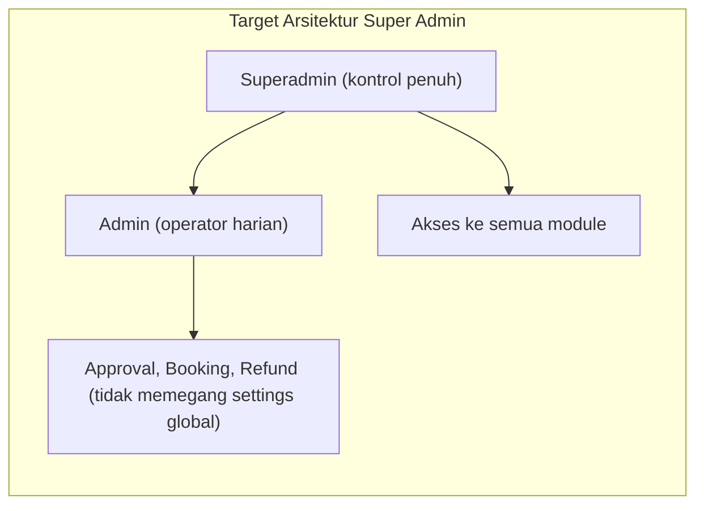

# Arsitektur Role Admin — UML Diagrams (Mermaid)

> **Tanggal:** 29 Juli 2026
> **Sumber data:** Deep check `superadmin-deepcheck.md`
> **Status:** Admin = kontrol penuh (single role, tanpa superadmin terpisah)

---

## 1. Deployment/Component Diagram — Lapisan Arsitektur

```mermaid
flowchart TB
    subgraph Client["🖥️ Client"]
        B["Browser\nReact + Inertia"]
    end

    subgraph FE["📁 Frontend Layer (resources/js)"]
        AL["AdminLayout.tsx\nSidebar: 11 menu"]
        PAGES["11 Admin Pages\n~3.900 baris"]
        HTTP["lib/http.ts\nfetch wrapper\n(XSRF cookie)"]
        PAGES --> HTTP
        AL --> PAGES
    end

    subgraph BE["🔧 Backend Layer (Laravel)"]
        RT["routes/web.php (11) \n routes/api/admin.php (36) \n routes/api/analytics.php (2)"]
        MDW["Middleware:\nCheckRole (role:admin)\nAdminMiddleware (dead code)"]
        CTL["13 Admin Controllers"]
        RES["Resources:\nCafeResource, UserResource,\nMenuOrderResource, FeaturedCafeResource"]
        MDW --> CTL
        RT --> MDW
        CTL --> RES
    end

    subgraph DATA["💾 Data Layer"]
        ORM["Eloquent Models:\nCafe, User, Booking, RefundRequest,\nCommissionRule, AdminAuditLog,\nNotification, FeaturedCafe, MenuOrder"]
        MYSQL[("MySQL\nusers.role = string\n(default 'customer')")]
        ORM --> MYSQL
    end

    B -->|Inertia request| FE
    FE -->|"fetch /api/admin/*"| RT
    BE --> DB["📁 Data Layer"]
    DB --> ORM
```

---

## 2. Use Case Diagram — Peran Admin (Kontrol Penuh)

```mermaid
flowchart LR
    A["👤 Admin\nUserRole::Admin\n(kontrol penuh)"]

    subgraph USE["Use Case Admin"]
        UC2["Dashboard & Metrik"]
        UC3["Approval Cafe\n(approve/reject)"]
        UC4["Manajemen Cafe\n(suspend/unsuspend)"]
        UC5["Manajemen Booking\n(cancel)"]
        UC6["Manajemen Refund\n(process/reject)"]
        UC7["Featured Cafe CRUD"]
        UC8["Komisi Rate"]
        UC9["Manajemen User\n(suspend)"]
        UC10["Audit Log"]
        UC11["Analytics & CSV Export"]
        UC12["Admin Login (API)\ntoken role:admin"]
    end

    A --> USE
```

---

## 3. Class Diagram — Controller Admin & Relasinya

```mermaid
classDiagram
    class CheckRole {
        +handle(req, next, ...roles)
    }
    class AdminMiddleware {
        +handle(req, next)
    }

    class AdminCafeRegistrationController {
        +index(): JsonResponse
        +show(Cafe): JsonResponse
        +approve(req, Cafe): JsonResponse
        +reject(req, Cafe): JsonResponse
        +formatCafe(Cafe): array
    }

    class AdminCafeController {
        +index(req): JsonResponse
        +show(Cafe): JsonResponse
        +suspend(req, Cafe): JsonResponse
        +unsuspend(req, Cafe): JsonResponse
    }

    class AdminUserController {
        +index(req): JsonResponse
        +update(req, User): JsonResponse
        +suspend(req, User): JsonResponse
        +unsuspend(User): JsonResponse
    }

    class AdminBookingController {
        +index(req): JsonResponse
        +show(Booking): JsonResponse
        +cancel(req, Booking): JsonResponse
    }

    class AdminRefundController {
        +index(req): JsonResponse
        +show(RefundRequest): JsonResponse
        +process(req, RefundRequest): JsonResponse
        +reject(req, RefundRequest): JsonResponse
    }

    class AdminFeaturedCafeController {
        +index(): JsonResponse
        +store(req): JsonResponse
        +update(req, FeaturedCafe): JsonResponse
        +destroy(req, FeaturedCafe): JsonResponse
    }

    class AdminCommissionController {
        +rates(): JsonResponse
        +history(req): JsonResponse
        +updateRate(req, type): JsonResponse
    }

    class AdminAuditLogController {
        +index(req): JsonResponse
    }

    class AdminDashboardController {
        +index(): Response
    }

    class AdminAnalyticsController {
        +index(req): JsonResponse
        +revenue(req): JsonResponse
        +topCafes(req): JsonResponse
        +bookingStatus(): JsonResponse
        +exportCsv(req): JsonResponse
    }

    class PlatformAdminAnalytics {
        +platform(req): JsonResponse
        +commission(req): JsonResponse
    }

    class AdminAuthController {
        +login(LoginRequest): JsonResponse
    }

    AdminCafeRegistrationController --> Cafe
    AdminCafeController --> Cafe
    AdminUserController --> User
    AdminBookingController --> Booking
    AdminRefundController --> RefundRequest
    AdminFeaturedCafeController --> FeaturedCafe
    AdminCommissionController --> CommissionRule
    AdminAuditLogController --> AdminAuditLog
    AdminAnalyticsController --> Booking
    AdminAnalyticsController --> Cafe
    PlatformAdminAnalytics --> Booking
    AdminDashboardController --> Cafe
    AdminDashboardController --> Booking
    AdminDashboardController --> User
```

---

## 4. Sequence Diagram — Alur Approval Cafe

---

## 5. Sequence Diagram — User Management (Suspend)

---

## 6. State Diagram — Siklus Status Cafe

---

## 7. Gaps yang Terlihat di UML

| # | Diagram | Visualisasi Gap |
|:-:|---------|-----------------|
| 1 | Sequence 5 | Audit log **tidak ada** — sequence bergerak langsung ke User Table tanpa node audit |
| 2 | Sequence 4 | Di approve/reject — **status transition tidak dicek** (cafe active bisa langsung kembali ke rejected) |
| 3 | Class 3 | `AdminCafeController.update` **tidak ada** tapi route `PATCH /api/admin/cafes/{id}` mengarahkan ke sana |
| 4 | Class 3 | Tidak ada route untuk `AdminOrderController` — **dead code**; FE Order Oversight menunjuk `/api/admin/orders` yang tidak terdaftar |
| 5 | State | Penambahan `pending --> pending` menunjukkan **tidak ada lifecycle enforcement** |

---

## 8. Rekomendasi Evolusi — Target Arsitektur Superadmin (Future)

Saat ini `Admin` = superadmin (kontrol penuh) dengan gate `role:admin` di semua route backend. Jika ingin dipecah:

Langkah yang diperlukan:

| Langkah | Detail |
|:-------:|--------|
| Enum | Tambah `UserRole::SuperAdmin = 'superadmin'` |
| Middleware | `role:superadmin` untuk route sensitif (commission rates, role change, audit) |
| API | Route `POST /api/admin/users/{id}/role` — hanya superadmin yang bisa ubah role |
| UI | Badge "Super Admin" dinamis dari `user.role` (bukan hardcoded di AdminLayout.tsx:80) |
| Seeder | Tambah user `superadmin@test.local` di `UserRoleSeeder` |

---

## 9. Ringkasan Arsitektur Saat Ini

| Aspek | Nilai |
|-------|-------|
| Role | 3 (customer, owner, admin) — **tanpa superadmin** |
| Route admin | 50 (11 web + 36 API + 2 analytics + 1 login) |
| Controller admin | 13 (2 dead/broken) |
| Halaman FE admin | 11 (~3.900 baris) |
| Middleware aktif | `role:admin` (CheckRole) |
| Middleware dead | `AdminMiddleware` (alias admin, tidak dipakai) |
| Audit log | Ada (approve/reject/featured) tapi tidak lengkap (6 aksi tanpa log) |
| Komisi | Dua sumber: hardcode 15% (dashboard) vs kolom `commission` (analytics) |
