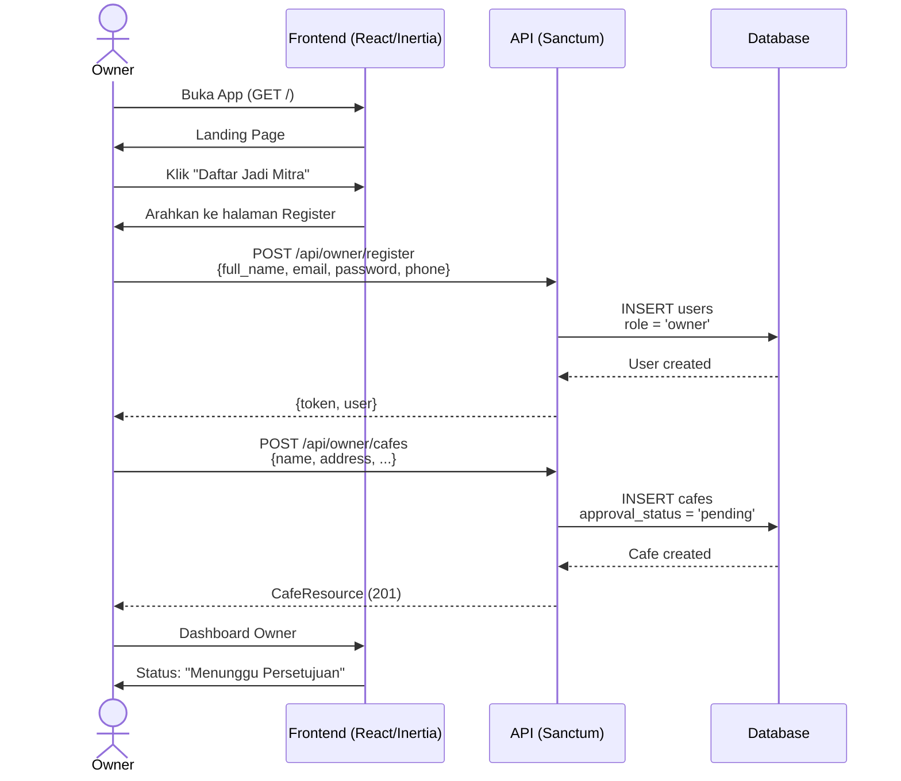
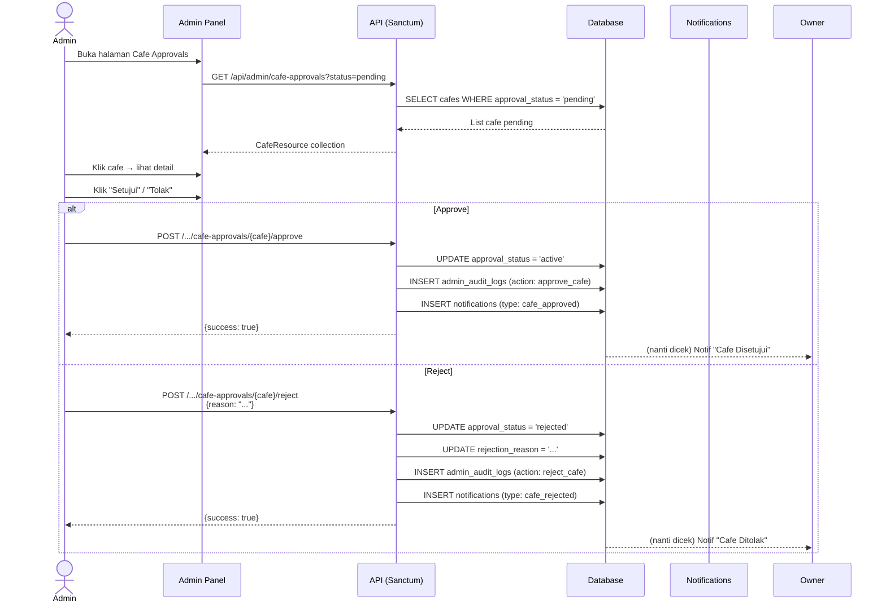
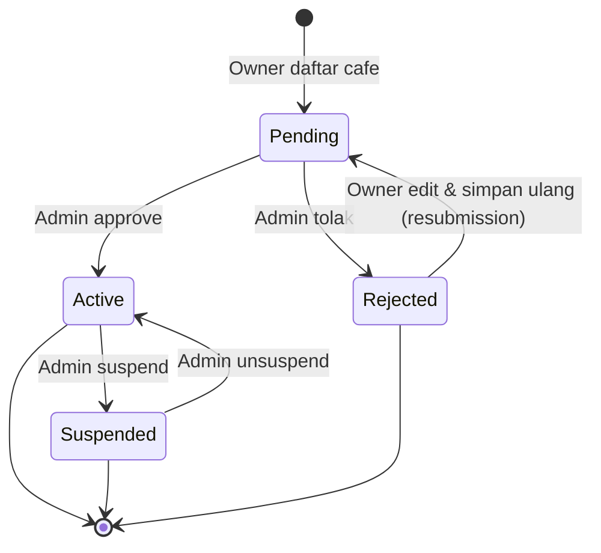
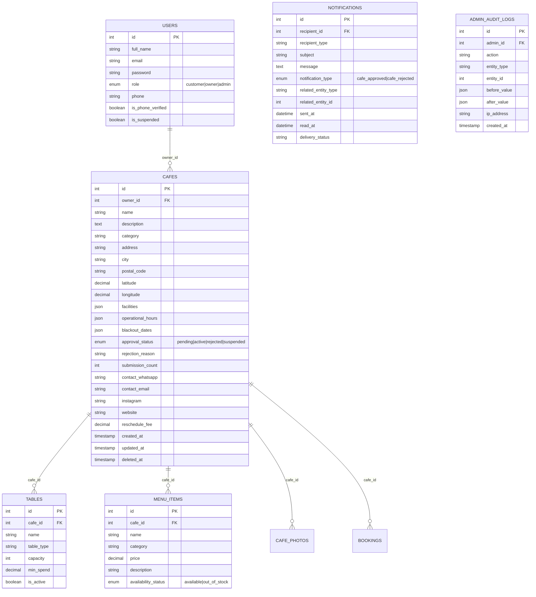

# Analisis Flow Owner — CafeNow

> **Dokumen:** Analisis alur lengkap pemilik cafe (owner) dari membuka aplikasi hingga kafenya mendapat persetujuan admin.
> **Tanggal:** 29 Juli 2026
> **Proyek:** CafeNow

---

## Daftar Isi

1. [Ringkasan Flow](#1-ringkasan-flow)
2. [Teknologi & Arsitektur](#2-teknologi--arsitektur)
3. [Breakdown Detail Per Tahap](#3-breakdown-detail-per-tahap)
4. [Diagram Alur (Mermaid)](#4-diagram-alur-mermaid)
5. [Peta File Terkait](#5-peta-file-terkait)
6. [Status & Enum](#6-status--enum)
7. [Gap & Issues Terdeteksi](#7-gap--issues-terdeteksi)
8. [Rekomendasi Prioritas](#8-rekomendasi-prioritas)
9. [Fitur 1 — Foto Per Kategori Meja](#9-fitur-1--foto-per-kategori-meja)
10. [Fitur 2 — Owner Registration Web Flow](#10-fitur-2--owner-registration-web-flow)
11. [Fitur 3 — Resubmission Cafe Ditolak](#11-fitur-3--resubmission-cafe-ditolak)

---

## 1. Ringkasan Flow

```
Buka App → Landing Page → Register Owner → Login → Dashboard Owner → Daftar Cafe → Admin Review → Approve/Reject
```

| Tahap | Nama | Entry Point |
|-------|------|-------------|
| 1 | Landing Page (Welcome) | `GET /` |
| 2 | Register Owner | `POST /api/owner/register` |
| 3 | Login Owner | `POST /api/owner/login` |
| 4 | Dashboard Owner | `GET /owner/dashboard` |
| 5 | Daftarkan Cafe | `POST /owner/cafes` atau `POST /api/owner/cafes` |
| 6 | Kelola Meja, Menu, Foto | Berbagai endpoint owner |
| 7 | Admin Approve/Reject | `POST /api/admin/cafe-approvals/{cafe}/approve \| reject` |
| 8 | Notifikasi ke Owner | Tabel `notifications` (tipe: `cafe_approved` / `cafe_rejected`) |

---

## 2. Teknologi & Arsitektur

| Layer | Teknologi |
|-------|-----------|
| **Backend Framework** | Laravel 11 |
| **Frontend Framework** | React 19 + Inertia.js |
| **API Auth** | Laravel Sanctum (token-based) |
| **Web Auth** | Laravel Fortify (session-based) |
| **Styling** | Tailwind CSS + shadcn/ui |
| **Bahasa** | PHP 8.4 + TypeScript |
| **Database** | SQLite |
| **Middleware Role** | `CheckRole` middleware (custom) |
| **Routing** | Web (Inertia) + API (JSON) — dual system |

---

## 3. Breakdown Detail Per Tahap

### Tahap 1: Landing Page (Welcome Page)

| Item | Detail |
|------|--------|
| Route | `GET /` (web.php:8) |
| Controller | `CafeController@welcome` (`app/Http/Controllers/Cafe/CafeController.php:55`) |
| Frontend | `resources/js/pages/welcome.tsx` |
| Backend View | Laravel Inertia render ke React |
| Data yg Dikirim | 8 cafes (status active/pending), 6 menu items, stats counter |
| Komponen Utama | Hero banner, search bar, kategori cafe, cafe cards, menu cards, statistik, **form partnership** |

**Form Partnership di Landing Page:**
- Fields: `cafe_name`, `owner_name`, `phone`, `area`
- **Status: PALSU (simulasi saja)** — tidak mengirim ke API manapun
- Hanya mengubah state `submittedPartner = true` di frontend
- Owner tidak benar-benar terdaftar

---

### Tahap 2: Register Owner

Aplikasi memiliki **dua sistem auth paralel**:

#### Jalur A: Register Customer via Web (Fortify)

| Item | Detail |
|------|--------|
| Route | `GET /register`, `POST /register` |
| Controller | Laravel Fortify (`vendor/laravel/fortify`) |
| Frontend | `resources/js/pages/auth/register.tsx` |
| Fields | `name`, `email`, `password`, `password_confirmation` |
| Role Default | **customer** (tidak ada pilihan role) |
| Mekanisme | Session-based, redirect ke `/dashboard` setelah berhasil |

#### Jalur B: Register Owner via API (Sanctum) ✅ **Jalur utama owner**

| Item | Detail |
|------|--------|
| Route | `POST /api/owner/register` |
| Controller | `OwnerAuthController@register` (`app/Http/Controllers/Auth/OwnerAuthController.php:22`) |
| Request | `RegisterRequest` (`app/Http/Requests/Auth/RegisterRequest.php`) |
| Fields | `full_name`*, `email`*, `password`*, `phone`*, `date_of_birth` |
| Role | `UserRole::Owner` (ditetapkan otomatis) |
| Validasi | `email:unique`, `password:min:8,regex:/[A-Z]/,regex:/[0-9]/,regex:/[@$!%*#?&]/`, `phone:unique` |
| Response | `{token, user}` — **201 Created** |
| Auto-login | Token langsung dibuat via `createToken('owner-token', ['role:owner'])` |

> **🗒️ Catatan:** Owner tidak punya halaman register web. Satu-satunya cara daftar adalah via API.

---

### Tahap 3: Login Owner

| Item | Detail |
|------|--------|
| Route | `POST /api/owner/login` |
| Controller | `OwnerAuthController@login` (`OwnerAuthController.php:47`) |
| Request | `LoginRequest` |
| Validasi | Cek email + password via `Hash::check()` |
| Role Check | Jika `role !== Owner` → **403 FORBIDDEN** (`"Akun ini bukan owner"`) |
| Response | `{token (scope: role:owner), user}` |

**Forgot/Reset Password:**
| Route | Fungsi |
|-------|--------|
| `POST /api/owner/forgot-password` | Kirim link reset via `Password::sendResetLink` |
| `POST /api/owner/reset-password` | Reset password via token |

---

### Tahap 4: Dashboard Owner

| Item | Detail |
|------|--------|
| Route | `GET /owner/dashboard` |
| Controller | `OwnerDashboardController@index` (`OwnerDashboardController.php:25`) |
| Frontend | `resources/js/pages/owner/dashboard.tsx` |
| Layout | `resources/js/components/Owner/OwnerLayout.tsx` |
| Middleware | `auth`, `verified`, `role:owner` |

**Logika Dashboard:**
```
if (user->cafe == null):
    → cafe = null
    → Tampilkan warning banner "Belum Mendaftarkan Cafe"
    → Semua metrics = 0
else:
    → Hitung revenue today (gross * 85%)
    → Total booking hari ini
    → Pending check-in
    → Total orders
    → 10 recent bookings & orders
    → 7-day revenue trend → bar chart
```

**Komponen Dashboard:**
- Stat cards (4): Revenue Today, Total Booking, Pending Check-In, Total Orders
- Shortcut grid (6): Info Cafe, Meja & Surge, Kelola Menu, Booking Masuk, Order Dapur, Analytics
- Recent bookings monitor (7 kolom)
- Kitchen live orders monitor
- Grafik pendapatan 7 hari

---

### Tahap 5: Mendaftarkan Cafe

Juga memiliki **dua jalur**:

#### Jalur A: Web Form (Inertia)

| Item | Detail |
|------|--------|
| Route | `POST /owner/cafes` |
| Controller | `OwnerDashboardController@storeCafe` (`OwnerDashboardController.php:421`) |
| Frontend | `resources/js/pages/owner/cafes/index.tsx` |
| Fields | `name*`, `address*`, `phone`, `description` |
| Cek Duplikasi | `if ($user->cafe) → error "Anda sudah memiliki profil cafe"` |
| Setelah Create | `approval_status = 'pending'` |
| Hardcoded | `city = 'Jakarta Pusat'` |
| Redirect | `/owner/cafes` dengan flash `success` |

#### Jalur B: API (Sanctum)

| Item | Detail |
|------|--------|
| Route | `POST /api/owner/cafes` |
| Controller | `OwnerCafeController@store` (`OwnerCafeController.php:19`) |
| Request | `StoreCafeRequest` |
| Cek Duplikasi | `Cafe::where('owner_id', ...)->exists()` → 409 CONFLICT |
| Response | JSON 201 `CafeResource` |

**Setelah cafe dibuat — fitur yang tersedia untuk owner:**

| Fitur | Route Web | Route API | Controller Method |
|-------|-----------|-----------|-------------------|
| Edit cafe | `PUT /owner/cafes/{cafe}` | `PUT /api/owner/cafes/{cafe}` | `OwnerDashboardController@updateCafe` / `OwnerCafeController@update` |
| Tambah meja | `POST /owner/cafes/tables` | — | `OwnerDashboardController@storeTable` |
| Edit meja | `PUT /owner/cafes/tables/{table}` | — | `OwnerDashboardController@updateTable` |
| Hapus meja | `DELETE /owner/cafes/tables/{table}` | — | `OwnerDashboardController@destroyTable` |
| Tambah menu | `POST /owner/cafes/menus` | — | `OwnerDashboardController@storeMenu` |
| Edit menu | `PUT /owner/cafes/menus/{menu}` | — | `OwnerDashboardController@updateMenu` |
| Hapus menu | `DELETE /owner/cafes/menus/{menu}` | — | `OwnerDashboardController@destroyMenu` |
| Upload foto | — | `POST /api/owner/cafes/{cafe}/photos` | `OwnerCafeController@uploadPhotos` |
| Hapus foto | — | `DELETE /api/owner/cafes/{cafe}/photos/{photoId}` | `OwnerCafeController@deletePhoto` |
| Set jam ops | — | `POST /api/owner/cafes/{cafe}/hours` | `OwnerCafeController@setHours` |
| Set blackout | — | `POST /api/owner/cafes/{cafe}/blackout` | `OwnerCafeController@setBlackout` |

> **PENTING:** Owner bisa mengisi meja, menu, dan foto **sebelum approval**. Tapi cafe tidak muncul di publik sampai `approval_status = 'active'`.

---

### Tahap 6: Status Approval Cafe

| Status | Makna | Enum Class |
|--------|-------|------------|
| `pending` | Menunggu review admin | `CafeApprovalStatus::Pending` |
| `active` | Disetujui, tampil di publik | `CafeApprovalStatus::Active` |
| `rejected` | Ditolak (ada `rejection_reason`) | `CafeApprovalStatus::Rejected` |
| `suspended` | Ditangguhkan oleh admin | `CafeApprovalStatus::Suspended` |

**Visibilitas Cafe Berdasarkan Status:**

| Endpoint | Status yg Ditampilkan | File |
|----------|----------------------|------|
| `CafeController@welcome` | `approved`, `active`, `pending` | `CafeController.php:57` |
| `CafeController@publicList` | `approved`, `active`, `pending` | `CafeController.php:30` |
| `CafeController@index` (list publik) | **`active` only** (via scope `active()`) | `CafeController.php:202` |
| `CafeController@show` (detail) | **`active`, `approved` only** (selain itu 404) | `CafeController.php:273` |

> **⚠️ Inkonsistensi:** Ada status `approved` yang digunakan di beberapa tempat sebagai fallback, padahal enum hanya punya `active`. Scope `active()` di Model Cafe hanya query `approval_status = 'active'`.

---

### Tahap 7: Admin Approval

| Item | Detail |
|------|--------|
| Halaman Web | `GET /admin/cafe-approvals` (Inertia) |
| Layout Frontend | `resources/js/pages/admin/Cafe/Approvals.tsx` |
| API Controller | `AdminCafeRegistrationController` |

**Endpoint API:**

| Method | Endpoint | Fungsi |
|--------|----------|--------|
| `GET` | `/api/admin/cafe-approvals` | List cafe (filter by status), default `pending` |
| `GET` | `/api/admin/cafe-approvals/{cafe}` | Detail cafe + owner + photos |
| `POST` | `/api/admin/cafe-approvals/{cafe}/approve` | **Setujui** cafe |
| `POST` | `/api/admin/cafe-approvals/{cafe}/reject` | **Tolak** cafe (wajib `reason`) |

**Saat Approve — `AdminCafeRegistrationController@approve()`:**
1. Update `cafe.approval_status = 'active'`
2. Reset `cafe.rejection_reason = null`
3. Buat `AdminAuditLog` (action: `approve_cafe`)
4. Buat `Notification` untuk owner:
   - `notification_type = 'cafe_approved'`
   - `message = "Cafe {name} Anda telah disetujui dan sekarang aktif."`
5. Return JSON `CafeResource`

**Saat Reject — `AdminCafeRegistrationController@reject()`:**
1. Validasi `reason` (required, string, max 1000)
2. Update `cafe.approval_status = 'rejected'`
3. Set `cafe.rejection_reason = reason`
4. Buat `AdminAuditLog` (action: `reject_cafe`)
5. Buat `Notification` untuk owner:
   - `notification_type = 'cafe_rejected'`
   - `message = "Cafe {name} Anda ditolak. Alasan: {reason}"`
6. Return JSON `CafeResource`

---

## 4. Diagram Alur (Mermaid)

### 4.1 Flowchart — Owner Journey (End-to-End)

```mermaid
graph TD
    A[Mulai: Buka Aplikasi] --> B[Landing Page /welcome]
    B --> C{Punya Akun?}
    C -->|Belum| D[Register Owner<br/>POST /api/owner/register]
    C -->|Sudah| E[Login Owner<br/>POST /api/owner/login]
    D --> F[Dapat Token + UserResource]
    E --> F
    F --> G[Dashboard Owner<br/>GET /owner/dashboard]
    G --> H{Punya Cafe?}
    H -->|Belum| I[Daftar Cafe<br/>POST /owner/cafes]
    I --> J[Dashboard Owner<br/>cafe.approval_status = pending]
    H -->|Sudah| K{approval_status?}
    J --> K
    K -->|pending| L[Kelola Meja & Menu<br/>sambil nunggu]
    K -->|active| M[Terima Booking & Pesanan]
    K -->|rejected| N[Lihat rejection_reason<br/>→ Perbaiki data]
    N --> O[Edit Cafe<br/>PUT /owner/cafes/{cafe}]
    O --> I
    L --> P[Admin Review<br/>POST /api/admin/cafe-approvals]
    P --> Q{Admin Approve?}
    Q -->|Ya| R[approval_status = active<br/>Notif: cafe_approved]
    Q -->|Tidak| S[approval_status = rejected<br/>Notif: cafe_rejected]
    R --> M
    S --> N
```

### 4.2 Sequence Diagram — Register & Daftar Cafe



### 4.3 Sequence Diagram — Admin Approval



### 4.4 State Diagram — Status Cafe



### 4.5 ERD — Model Terkait



---

## 5. Peta File Terkait

### 5.1 Backend (PHP/Laravel)

| File (path dari root project) | Peran |
|-------------------------------|-------|
| `routes/web.php` | Web routes: landing page, dashboard owner, admin Inertia pages |
| `routes/api.php` | Loader semua file route API |
| `routes/api/auth.php` | API auth routes: register/login owner, customer |
| `routes/api/cafes.php` | API cafe routes: public list, owner CRUD |
| `routes/api/admin.php` | API admin routes: approvals, management |
| `app/Http/Controllers/Auth/OwnerAuthController.php` | Register & login owner via API |
| `app/Http/Controllers/Cafe/OwnerCafeController.php` | CRUD cafe via API (store, update, photos, hours, blackout) |
| `app/Http/Controllers/Cafe/CafeController.php` | Public pages (welcome, list, detail) |
| `app/Http/Controllers/Owner/OwnerDashboardController.php` | Dashboard owner + cafe/table/menu CRUD via web |
| `app/Http/Controllers/Admin/AdminCafeRegistrationController.php` | Admin approve/reject cafe |
| `app/Http/Controllers/Admin/AdminCafeController.php` | Admin manage cafe (suspend, edit) |
| `app/Models/Cafe.php` | Model Cafe |
| `app/Models/User.php` | Model User (role: customer/owner/admin) |
| `app/Models/Notification.php` | Notifikasi untuk owner |
| `app/Models/AdminAuditLog.php` | Log aktivitas admin |
| `app/Models/Table.php` | Model meja cafe |
| `app/Models/MenuItem.php` | Model menu item |
| `app/Models/CafePhoto.php` | Model foto cafe |
| `app/Http/Middleware/CheckRole.php` | Middleware role-based access |
| `app/Enums/UserRole.php` | Enum role: Customer, Owner, Admin |
| `app/Enums/CafeApprovalStatus.php` | Enum status: Pending, Active, Suspended, Rejected |
| `app/Http/Requests/Auth/RegisterRequest.php` | Validasi register owner |
| `app/Http/Requests/Auth/LoginRequest.php` | Validasi login |
| `app/Http/Resources/UserResource.php` | Resource transform untuk User |
| `app/Http/Resources/CafeResource.php` | Resource transform untuk Cafe |
| `app/Services/Auth/OtpService.php` | Layanan OTP (untuk customer) |
| `database/migrations/0001_01_01_000000_create_users_table.php` | Migrasi users |
| `database/migrations/0001_01_01_000010_create_cafes_table.php` | Migrasi cafes |
| `database/migrations/0001_01_01_000020_create_tables_table.php` | Migrasi tables |
| `database/migrations/0001_01_01_000050_create_menu_items_table.php` | Migrasi menu items |
| `database/migrations/0001_01_01_000011_create_cafe_photos_table.php` | Migrasi cafe photos |
| `database/migrations/0001_01_01_000080_create_notifications_table.php` | Migrasi notifications |
| `database/migrations/0001_01_01_000101_create_admin_audit_logs_table.php` | Migrasi admin audit logs |

### 5.2 Frontend (React/TypeScript)

| File (path dari `resources/js/`) | Peran |
|----------------------------------|-------|
| `pages/welcome.tsx` | Landing page publik |
| `pages/auth/register.tsx` | Register customer (Fortify) |
| `pages/auth/login.tsx` | Login customer (Fortify) |
| `pages/owner/dashboard.tsx` | Dashboard owner |
| `pages/owner/cafes/index.tsx` | Daftar & edit info cafe |
| `pages/owner/cafes/tables.tsx` | Kelola meja |
| `pages/owner/cafes/menus.tsx` | Kelola menu |
| `pages/owner/analytics.tsx` | Analitik owner |
| `pages/owner/bookings.tsx` | Manajemen booking |
| `pages/owner/orders.tsx` | Live order dapur |
| `pages/admin/Cafe/Approvals.tsx` | Halaman approval admin |
| `pages/admin/Cafe/Management.tsx` | Manajemen cafe admin |
| `pages/admin/dashboard.tsx` | Dashboard admin |
| `components/Owner/OwnerLayout.tsx` | Layout sidebar owner |
| `components/Admin/AdminLayout.tsx` | Layout sidebar admin |
| `layouts/app-layout.tsx` | Layout utama app |
| `types/index.ts` | Tipe global |

---

## 6. Status & Enum

### 6.1 UserRole (`app/Enums/UserRole.php`)

```php
enum UserRole: string
{
    case Customer = 'customer';
    case Owner    = 'owner';
    case Admin    = 'admin';
}
```

### 6.2 CafeApprovalStatus (`app/Enums/CafeApprovalStatus.php`)

```php
enum CafeApprovalStatus: string
{
    case Pending   = 'pending';
    case Active    = 'active';
    case Suspended = 'suspended';
    case Rejected  = 'rejected';
}
```

### 6.3 NotificationType (digunakan di kode)

| Type | Konteks |
|------|---------|
| `cafe_approved` | Cafe disetujui admin |
| `cafe_rejected` | Cafe ditolak admin |

### 6.4 AdminAuditLog Action

| Action | Konteks |
|--------|---------|
| `approve_cafe` | Admin menyetujui cafe |
| `reject_cafe` | Admin menolak cafe |

---

## 7. Gap & Issues Terdeteksi

### 🚩 GAP-01: Dua Jalur Auth Tidak Terintegrasi
- **Deskripsi:** Register web (Fortify) hanya bikin role `customer`. Owner harus daftar via API (`POST /api/owner/register`).
- **Dampak:** Owner tidak punya halaman register web — hanya bisa via API (Postman / mobile app).
- **Lokasi:** `routes/api/auth.php:30` vs `routes/web.php` (Fortify)
- **Severity:** **Kritis**

### 🚩 GAP-02: Form Mitra di Landing Page Adalah Simulasi
- **Deskripsi:** Form partnership di `welcome.tsx` (field: cafe_name, owner_name, phone, area) hanya mengubah state `submittedPartner = true` — tidak ada API call.
- **Dampak:** Owner mengira sudah mendaftar padahal tidak.
- **Lokasi:** `resources/js/pages/welcome.tsx:60-61`
- **Severity:** **Kritis**

### 🚩 GAP-03: Hardcoded City
- **Deskripsi:** Saat daftar cafe via web, city selalu `'Jakarta Pusat'`.
- **Lokasi:** `OwnerDashboardController.php:440`
- **Severity:** **Sedang**

### 🚩 GAP-04: Tidak Ada Resubmission Flow
- **Deskripsi:** Cafe di-reject → status `rejected`. Tidak ada mekanisme owner untuk mengubah status kembali ke `pending`. Field `submission_count` tidak pernah di-increment.
- **Dampak:** Owner tidak bisa mengirim ulang cafe setelah ditolak.
- **Lokasi:** `AdminCafeRegistrationController.php`
- **Severity:** **Tinggi**

### 🚩 GAP-05: Visibilitas Cafe Tidak Konsisten
- **Deskripsi:** Beberapa endpoint menggunakan `approved` sebagai fallback, beberapa hanya `active`. Scope `active()` hanya query `approval_status = 'active'` tanpa `approved`.
- **Lokasi:** `CafeController.php:30,57,202,273` + `Cafe.php:72-75`
- **Severity:** **Sedang**

### 🚩 GAP-06: Notifikasi Hanya via Database
- **Deskripsi:** Notifikasi untuk owner saat approve/reject hanya disimpan di tabel `notifications`. Tidak ada email atau push notification.
- **Lokasi:** `AdminCafeRegistrationController.php:68-78, 106-116`
- **Severity:** **Rendah**

### 🚩 GAP-07: Tidak Ada Syarat Minimal Approval
- **Deskripsi:** Admin bisa approve cafe meski belum ada meja, menu, atau foto.
- **Lokasi:** `AdminCafeRegistrationController@approve()`
- **Severity:** **Sedang**

### 🚩 GAP-08: Owner Cafe Model `slug` Tidak Ada di Database
- **Deskripsi:** Frontend mengirim `slug` ke owner cafe page, tapi kolom `slug` tidak ada di tabel `cafes`.
- **Lokasi:** `resources/js/pages/owner/cafes/index.tsx:8`
- **Severity:** **Rendah**

### 🚩 GAP-09: AdminApprovals Frontend vs Backend Tidak Sinkron
- **Deskripsi:** Frontend admin `Approvals.tsx` menggunakan komponen `Card`, `Button`, `Badge`, `Modal` custom yang mungkin tidak konsisten dengan tema Tailwind/shadcn. Backend response menggunakan `api.http` yang mungkin deprecated.
- **Lokasi:** `resources/js/pages/admin/Cafe/Approvals.tsx`
- **Severity:** **Rendah**

---

## 8. Rekomendasi Prioritas

| Prio | Item | Gap | Estimasi |
|------|------|-----|----------|
| **P1** | Integrasi register owner ke frontend web (buat halaman register owner) | GAP-01, GAP-02 | 2 hari |
| **P1** | Perbaiki form mitra di landing page → arahkan ke register atau daftarkan langsung | GAP-02 | 0.5 hari |
| **P2** | Tambah resubmission flow untuk cafe ditolak (set ulang ke pending + increment submission_count) | GAP-04 | 1 hari |
| **P2** | Hapus hardcoded city, ambil dari form input / tambahkan field kota di form | GAP-03 | 0.5 hari |
| **P3** | Konsistensi scope approval — gunakan `active` saja, hapus semua referensi `approved` | GAP-05 | 0.5 hari |
| **P3** | Tambah validasi: cafe minimal punya 1 meja aktif & 1 menu untuk bisa diapprove | GAP-07 | 1 hari |
| **P3** | Integrasi email/push notification via Laravel Notification | GAP-06 | 1 hari |
| **P4** | Tambah kolom `slug` di tabel cafes | GAP-08 | 0.5 hari |
| **P4** | Sinkronisasi komponen admin dengan design system | GAP-09 | 1 hari |

---

## Lampiran

### A. Data Model — Struktur Tabel `cafes`

```
cafes
├── id                    BIGINT PK
├── owner_id              BIGINT FK → users.id
├── name                  VARCHAR(255)
├── description           TEXT nullable
├── category              VARCHAR nullable
├── address               VARCHAR
├── city                  VARCHAR
├── postal_code           VARCHAR(10) nullable
├── latitude              DECIMAL(10,7) nullable
├── longitude             DECIMAL(10,7) nullable
├── facilities            JSON nullable
├── operational_hours     JSON nullable
├── blackout_dates        JSON nullable
├── approval_status       VARCHAR(20) default 'pending'
├── rejection_reason      VARCHAR nullable
├── submission_count      INT default 1
├── contact_whatsapp      VARCHAR(20) nullable
├── contact_email         VARCHAR nullable
├── instagram             VARCHAR nullable
├── website               VARCHAR nullable
├── reschedule_fee        DECIMAL(12,2) default 5000
├── deleted_at            TIMESTAMP nullable (soft delete)
├── created_at            TIMESTAMP
└── updated_at            TIMESTAMP
```

### B. Data Model — Struktur Tabel `users`

```
users
├── id                    BIGINT PK
├── name                  VARCHAR
├── full_name             VARCHAR nullable
├── email                 VARCHAR UNIQUE
├── email_verified_at     TIMESTAMP nullable
├── role                  VARCHAR default 'customer'
├── phone                 VARCHAR(20) UNIQUE nullable
├── is_phone_verified     BOOLEAN default false
├── profile_pic           VARCHAR nullable
├── date_of_birth         DATE nullable
├── password              VARCHAR
├── is_suspended          BOOLEAN default false
├── two_factor_secret     TEXT nullable
├── two_factor_recovery_codes TEXT nullable
├── remember_token        VARCHAR nullable
├── created_at            TIMESTAMP
└── updated_at            TIMESTAMP
```

### C. Middleware — CheckRole

```php
// app/Http/Middleware/CheckRole.php
// Dipanggil via route: ->middleware(['role:owner']) atau ['role:admin']
// Cek: $user->role->value === salah satu dari daftar roles yang diizinkan
// Gagal → 403 "Tidak memiliki akses"
```

---

## 9. Fitur 1 — Foto Per Kategori Meja

### Tujuan

Owner dapat menambahkan foto untuk setiap meja yang didaftarkan. Foto ini akan ditampilkan ke pelanggan di halaman detail cafe saat memilih meja.

### Status Kolom `photo` di Tabel `tables`

| Item | Status |
|------|--------|
| Kolom `photo` di migration `create_tables_table` | ✅ **Sudah ada** (`string`, nullable) |
| `$fillable` di `Table.php` | ✅ Termasuk `photo` |
| `TableResource` expose `photo` | ✅ Sudah |
| Upload foto di form meja web | ❌ **Belum ada** |
| Tampilan meja + foto di detail cafe | ❌ **Belum ada** |

### Tipe Meja yang Ada

| `table_type` | Label |
|-------------|-------|
| `indoor` | Indoor |
| `outdoor` | Outdoor |
| `vip` | VIP |
| `regular` | Regular |
| `private` | Private Room |

### File yang Diubah (3 file — tanpa API)

| # | File | Tipe | Perubahan |
|---|------|------|-----------|
| 1 | `resources/js/pages/owner/cafes/tables.tsx` | Frontend | Tambah input file foto + preview di modal tambah/edit meja. Kirim sebagai `FormData` via Inertia. |
| 2 | `app/Http/Controllers/Owner/OwnerDashboardController.php` | Backend | **`storeTable()`** — jika ada `$request->hasFile('photo')`, simpan ke `storage/app/public/tables/`. **`updateTable()`** — jika ada file baru, hapus yang lama + simpan baru. |
| 3 | `resources/js/pages/cafes/detail.tsx` | Frontend | Tambah section **"Pilihan Meja"** — group by `table_type`, tampilkan foto meja (atau fallback placeholder), nama, kapasitas, harga. |

### Data Flow

```
[tables.tsx]
  → router.post('/owner/cafes/tables', FormData with photo)
  → OwnerDashboardController@storeTable
  → Simpan file ke storage/app/public/tables/
  → Simpan path ke DB (tables.photo)
  → Redirect back with flash success

[CafeController@show]
  → $cafe->load('tables')
  → Kirim data via Inertia render

[detail.tsx]
  → cafe.tables[] dengan photo_path
  → Tampilkan galeri per kategori meja
```

### Detail Logika Upload

```php
// storeTable() — Tambah meja baru
if ($request->hasFile('photo')) {
    $path = $request->file('photo')->store('tables', 'public');
    $data['photo'] = $path;
}

// updateTable() — Edit meja yang sudah ada
if ($request->hasFile('photo')) {
    if ($table->photo) Storage::delete($table->photo);
    $path = $request->file('photo')->store('tables', 'public');
    $data['photo'] = $path;
}
```

---

## 10. Fitur 2 — Owner Registration Web Flow

### Tujuan

Membuat halaman web registrasi owner yang terintegrasi dengan Fortify (session-based), bukan via API. Owner bisa daftar, verifikasi email, login, dan reset password dari browser.

### Kondisi Saat Ini

| Fitur | Web (Fortify) | API (Sanctum) |
|-------|:---:|:---:|
| Register | ✅ role `customer` saja | ✅ role = `owner` (token) |
| Login | ✅ redirect by role | ✅ (token) |
| Email Verification | ✅ (Fortify) | ❌ |
| Forgot Password | ✅ (Fortify) | ✅ |
| Reset Password | ✅ (Fortify) | ✅ |
| **Halaman Register Owner** | ❌ **Belum ada** | ❌ (hanya endpoint) |

### File yang Diubah/Dibuat (6 file)

| # | File | Status | Tipe | Deskripsi |
|---|------|--------|------|-----------|
| 1 | `resources/js/pages/auth/owner-register.tsx` | **Baru** | Frontend | Halaman register owner dengan form: `full_name`, `email`, `phone`, `password`, `password_confirmation`. Layout pakai `AuthLayout` yang sudah ada. |
| 2 | `routes/web.php` | **Diubah** | Route | Tambah `GET /owner/register` → render page. `POST /owner/register` → proses registrasi. |
| 3 | `app/Actions/Fortify/CreateOwnerUser.php` | **Baru** | Backend | Action register owner. Validasi + `User::create(role: Owner)` + trigger email verifikasi. |
| 4 | `resources/js/pages/auth/login.tsx` | **Diubah** | Frontend | Tambah link "Daftar sebagai Owner" mengarah ke `/owner/register`. |
| 5 | `resources/js/pages/welcome.tsx` | **Diubah** | Frontend | Arahkan form "Daftar Jadi Mitra" ke `/owner/register` (bukan simulasi). |
| 6 | `.env` | **Diubah** | Config | Setup Mailtrap SMTP untuk kirim email verifikasi & reset password. |

### Fields Register Owner

| Field | Validasi |
|-------|----------|
| `full_name` | required, string, max:255 |
| `email` | required, email, unique:users |
| `phone` | required, string, max:20, unique:users |
| `password` | required, min:8, confirmed |

### Email Notification (Mailtrap)

| Event | Email |
|-------|-------|
| Register | Verifikasi email (Fortify built-in) |
| Lupa password | Reset link (Fortify built-in) |
| Cafe disetujui | (belum — lihat GAP-06) |

**Konfigurasi `.env`:**

```env
MAIL_MAILER=smtp
MAIL_HOST=sandbox.smtp.mailtrap.io
MAIL_PORT=2525
MAIL_USERNAME=your_mailtrap_username
MAIL_PASSWORD=your_mailtrap_password
MAIL_FROM_ADDRESS="noreply@cafenow.app"
MAIL_FROM_NAME="${APP_NAME}"
```

### User Journey

```
Landing Page
  │
  ├─ "Daftar Jadi Mitra" → /owner/register
  │                         ├─ Isi form (nama, email, phone, password)
  │                         ├─ Submit → CreateOwnerUser (role=Owner)
  │                         ├─ Email verifikasi dikirim via Mailtrap
  │                         └─ Redirect ke /email/verify
  │                               │
  │                               ├─ Klik link di email → verified
  │                               └─ Redirect ke /login
  │
  └─ "Login" → /login
                 ├─ Isi email & password
                 ├─ Fortify cek role → Owner
                 └─ Redirect ke /owner/dashboard
```

### Catatan

- Owner login via web **pakai session** (Fortify), bukan token
- API endpoint `POST /api/owner/register` tetap ada untuk mobile app
- Tidak ubah `OwnerAuthController.php` (API)
- Tidak ubah `routes/api/auth.php`
- Fortify `LoginResponse` di `FortifyServiceProvider.php` sudah handle redirect owner ke `/owner/dashboard`

---

## 11. Fitur 3 — Resubmission Cafe Ditolak

### Tujuan

Owner bisa melihat alasan penolakan, memperbaiki data, dan mengirim ulang cafe untuk direview ulang oleh admin.

### Kondisi Saat Ini

| Aspek | Status |
|-------|--------|
| `rejection_reason` di DB (`cafes` table) | ✅ Ada |
| `submission_count` di DB (`cafes` table) | ✅ Ada (tapi **tidak pernah di-increment**) |
| Admin wajib isi alasan tolak | ✅ Backend validasi `reason` required |
| Owner lihat alasan penolakan | ❌ **Tidak ditampilkan** |
| Owner kirim ulang setelah diperbaiki | ❌ **Tidak ada mekanisme** |
| `approval_status` berubah saat edit | ❌ Status tetap `rejected` |

### Keputusan Desain

1. **Auto reset** — saat owner klik "Simpan Perubahan" pada cafe rejected, status otomatis balik ke `pending`
2. `submission_count` +1 setiap reset
3. **Rejection reason** ditampilkan di halaman owner
4. **Riwayat penolakan** dan submission count ditampilkan ke admin

### File yang Diubah (5 file)

| # | File | Tipe | Perubahan |
|---|------|------|-----------|
| 1 | `resources/js/pages/owner/cafes/index.tsx` | Frontend | Tampilkan `rejection_reason` dalam alert merah saat status `rejected`. Tambah info submission count. |
| 2 | `app/Http/Controllers/Owner/OwnerDashboardController.php` | Backend | **`cafes()`** — kirim `rejection_reason` ke frontend. **`updateCafe()`** — jika `approval_status === 'rejected'`, reset ke `pending`, nullkan `rejection_reason`, increment `submission_count`. |
| 3 | `app/Http/Resources/CafeResource.php` | Backend | Tambah field `rejection_reason` dan `submission_count` ke resource response. |
| 4 | `resources/js/pages/admin/Cafe/Approvals.tsx` | Frontend | Di modal detail admin, tampilkan riwayat penolakan: submission ke berapa, rejection reason sebelumnya, status history. |
| 5 | `routes/web.php` | Route | (Opsional) Jika perlu endpoint eksplisit untuk kirim ulang. |

### Detail Logika Update Cafe Saat Rejected

```php
// app/Http/Controllers/Owner/OwnerDashboardController.php
// Method: updateCafe()

$cafe->update([
    'name' => $validated['name'],
    'address' => $validated['address'],
    'contact_whatsapp' => $validated['phone'] ?? null,
    'description' => $validated['description'] ?? null,
]);

// Auto-reset jika sebelumnya ditolak
if ($cafe->approval_status === 'rejected') {
    $cafe->update([
        'approval_status' => 'pending',
        'rejection_reason' => null,
        'submission_count' => $cafe->submission_count + 1,
    ]);
}
```

### Tampilan Owner Saat Status Rejected

```
┌──────────────────────────────────────────────────────┐
│  ✗  Cafe Ditolak Admin                               │
│     Alasan: Foto tidak sesuai, harap upload foto      │
│     interior cafe yang jelas.                         │
│                                                       │
│     Silakan perbaiki data dan klik "Simpan Perubahan" │
│     untuk mengirim ulang.                    │
└──────────────────────────────────────────────────────┘

Status: ⏳ Menunggu Persetujuan  (Pengajuan ke-2)
```

### Data yang Admin Review

| Data | Saat Ini | Target |
|------|:--------:|:------:|
| Nama cafe | ✅ | ✅ |
| Alamat | ✅ | ✅ |
| Telepon | ✅ | ✅ |
| Deskripsi | ✅ | ✅ |
| Nama pemilik | ✅ | ✅ |
| Email pemilik | ✅ | ✅ |
| **Foto cafe** | ❌ | ✅ |
| **Daftar meja** | ❌ | ✅ |
| **Daftar menu** | ❌ | ✅ |
| **Fasilitas** | ❌ | ✅ |
| **Jam operasional** | ❌ | ✅ |
| **Riwayat penolakan** | ❌ | ✅ |
| **Submission ke-berapa** | ❌ | ✅ |

---

### Ringkasan Total Perubahan

| Fitur | File Baru | File Diubah | Total |
|-------|:---------:|:-----------:|:-----:|
| Foto Per Kategori Meja | 0 | 3 | 3 |
| Owner Registration Web Flow | 2 | 4 | 6 |
| Resubmission Cafe Ditolak | 0 | 5 | 5 |
| **Grand Total** | **2** | **12** | **14** |
